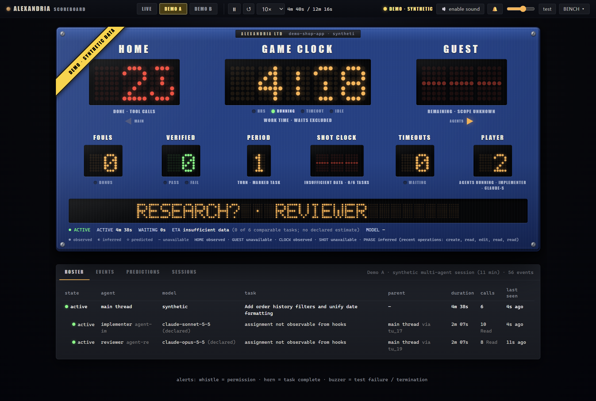
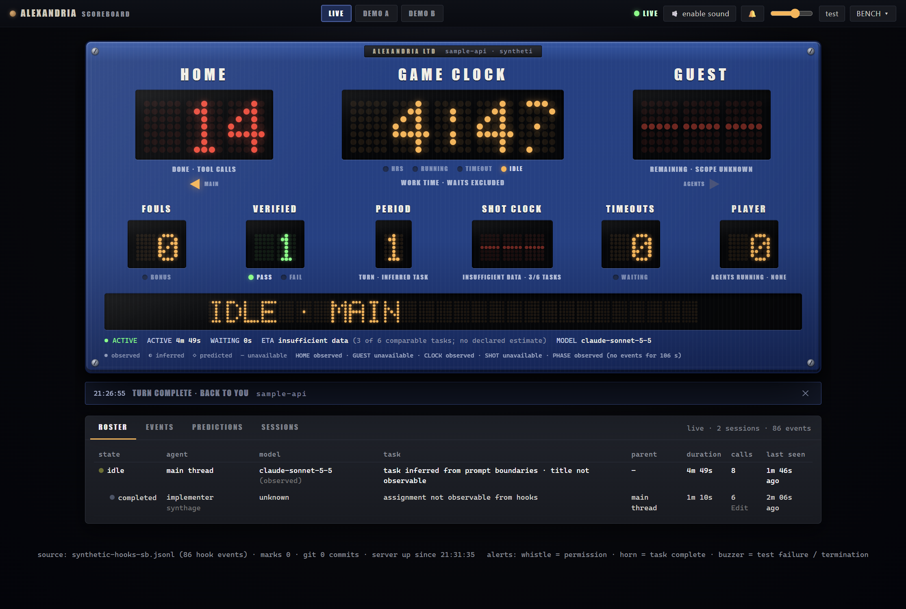

# Alexandria Scoreboard

A free, local companion for [Claude Code](https://claude.com/claude-code) by Alexandria Ltd. It shows a vintage
basketball scoreboard of what your Claude Code sessions and subagents are doing, how long the work has *actually*
taken (waiting time excluded), and a calibrated range for how long it will take.

Long agent runs are mostly invisible: you do not know whether Claude is working, waiting for you, rate limited, or
stuck, and a naive elapsed-time counter includes all the waiting. Alexandria Scoreboard makes that visible, and keeps
everything on your machine.

<!-- Screenshots use synthetic sessions (demo-shop-app, sample-api) and the bundled synthetic recordings; no real activity. -->




## Features

- **Live board.** Tool calls (HOME), turns (PERIOD), active-time GAME CLOCK, SHOT CLOCK with an ETA range, FOULS
  (failures), VERIFIED (passing tests, commits), TIMEOUTS (waits), PLAYER (agents running) and a phase message.
- **Stopwatch that excludes waiting.** Time is partitioned into active, waiting (approval, question, the user's move,
  rate limit, API error, external), paused and unknown, and every figure carries its basis (observed, inferred or
  declared). See [docs/STOPWATCH_ETA_V02.md](docs/STOPWATCH_ETA_V02.md).
- **Calibrated ETA ranges.** Remaining-time ranges built from your own history, with a stated confidence; no number is
  shown when there is no basis. See [docs/ETA_METHOD.md](docs/ETA_METHOD.md).
- **Sessions and subagents.** Every concurrent Claude Code session is tracked independently, with a roster of
  subagents and their observed models.
- **Alerts and sounds.** Approval requests, rate limits, failed tests and completed tasks raise banners; original
  synthesised sounds (whistle, buzzer, horn) can be muted.
- **Workflow analytics.** A content-free task ledger, a calibration backtest (`node tools/sb-calibrate.js evaluate`)
  and a controlled evaluation harness (`tools/sb-eval.js`).
- **Demo mode.** Two synthetic recordings replay through the same engine, so you can try the board without any data.

## Status: development preview

This is **source available, development-preview software**. There are **no official binaries yet**. Unsigned local
builds can be blocked by Windows Smart App Control; see [docs/BUILDING_WINDOWS.md](docs/BUILDING_WINDOWS.md).

- **Development builds** are what you build locally from source. They are unsigned.
- **Production releases** will be signed and published on the Releases page of this repository.

## Requirements

- Windows 10 or 11, x64 and ARM64 (tested). The browser version runs wherever Node.js runs.
- Node.js 22 or newer.
- [Claude Code](https://claude.com/claude-code), for live data. Demo mode works without it.

## Install and run from source

```
npm install
npm start                     # board at http://127.0.0.1:4340/ (browser)
npm run desktop               # desktop window (Electron)
npm test
```

Open the board and pick **DEMO A** or **DEMO B** to see it working immediately. Live mode needs the collector below.

Environment variables: `SB_PORT` (default 4340), `SB_DATA_DIR`, `SB_HOOK_LOG`, `SB_REPO_ROOTS` (semicolon-separated
folders searched for git repositories of your projects, default your home folder). The desktop app uses a random
local port.

To build a local Windows package, see [docs/BUILDING_WINDOWS.md](docs/BUILDING_WINDOWS.md).

## The collector

Live data comes from a small Claude Code hook, `collector/eta-hook.mjs`, that appends one JSON line per hook event to
`~/.claude/eta/events.jsonl`.

**What it logs:** timestamps, event kinds, session, prompt and tool-use ids, the project folder name, tool names, tool
durations, prompt *length*, subagent type and declared model, notification kinds, a redacted command signature (for
example `npm test`, never arguments) and pass/fail counts parsed from test output.

**What it never logs:** prompt text, tool inputs (commands, file contents, URLs), tool outputs, assistant messages,
notification text, environment variables or credentials. The event schema rejects payload keys that could carry
content, and the tests check this with marker strings.

### First-time installation (manual)

The installer upgrades an existing collector entry and does not create the first one, so install it once by hand.
Claude Code does not let an agent edit its own settings, so do this yourself.

1. Copy `collector/eta-hook.mjs` to `~/.claude/eta/eta-hook.mjs` (create the folder).
2. Back up `~/.claude/settings.json`.
3. Merge the `hooks` section of `collector/hooks.settings-fragment.json` into the `hooks` section of
   `~/.claude/settings.json`. In the fragment the command is written as `node "~/.claude/eta/eta-hook.mjs"`: **replace
   that path with the absolute path to your own copy** (for example `node "<home>/.claude/eta/eta-hook.mjs"`
   with `<home>` being your user folder, the folder that contains `.claude`), because the path must be the user's own.
4. Start a new Claude Code session. New lines appear in `~/.claude/eta/events.jsonl`.

To roll back, remove those hook entries and restore your backup.

### Upgrading an existing collector

Once a collector entry exists, the installer can bring it up to the current version:

```
node tools/install-collector-v3.mjs            # dry run: checks everything, changes nothing
node tools/install-collector-v3.mjs --apply    # backups, install, verify; prints the rollback command
```

It only adds missing hooks and never removes or downgrades anything.

## Marking tasks

`node tools/sb-mark.js start "Build the roster panel" --minutes 25 --p90 40` declares a task and an estimate;
`sb-mark end` completes it; `sb-mark tests -- npm test` records a test run; `sb-mark pause` / `resume` declare a pause.
Run `node tools/sb-mark.js` with no arguments for the usage line.

## Data location

Scoreboard data (task ledger, marks, predictions, calibration) is stored in `~/.claude/eta/scoreboard/`
(override with `SB_DATA_DIR`). The hook log is `~/.claude/eta/events.jsonl`. Delete these folders to remove all data.

## Privacy

Everything stays on your machine. The application makes no network requests, has no telemetry and no auto-update.
It reads the collector's log and your Claude Code transcripts (for model, token, rate-limit and waiting-time facts and
for calibration; content is stripped on ingest and only timings, ids, models and counts are kept) and, for commit counts, `git log` of your project folders. See
[docs/PRIVACY_SECURITY_LICENSING.md](docs/PRIVACY_SECURITY_LICENSING.md).

## Documentation

- [docs/SCOREBOARD.md](docs/SCOREBOARD.md): what each board field means and its basis
- [docs/STOPWATCH_ETA_V02.md](docs/STOPWATCH_ETA_V02.md): the stopwatch and the estimator
- [docs/ETA_METHOD.md](docs/ETA_METHOD.md): method and measurements
- [docs/ARCHITECTURE.md](docs/ARCHITECTURE.md), [docs/DESKTOP_ARCHITECTURE.md](docs/DESKTOP_ARCHITECTURE.md), [docs/TAXONOMY.md](docs/TAXONOMY.md)
- [docs/BUILDING_WINDOWS.md](docs/BUILDING_WINDOWS.md), [docs/ROADMAP.md](docs/ROADMAP.md)

## Contributing

Issues are welcome: bug reports, ideas and questions. Please do not include prompts, code or logs that contain private
information. Pull requests should keep `npm test` green and avoid new runtime dependencies.

## License

Apache License 2.0. See [LICENSE](LICENSE) and [NOTICE](NOTICE). Third-party components and their licences are listed
in [THIRD_PARTY_NOTICES.md](THIRD_PARTY_NOTICES.md).

"Alexandria" and "Alexandria Ltd" are names of the publisher; the licence does not grant trademark rights.
